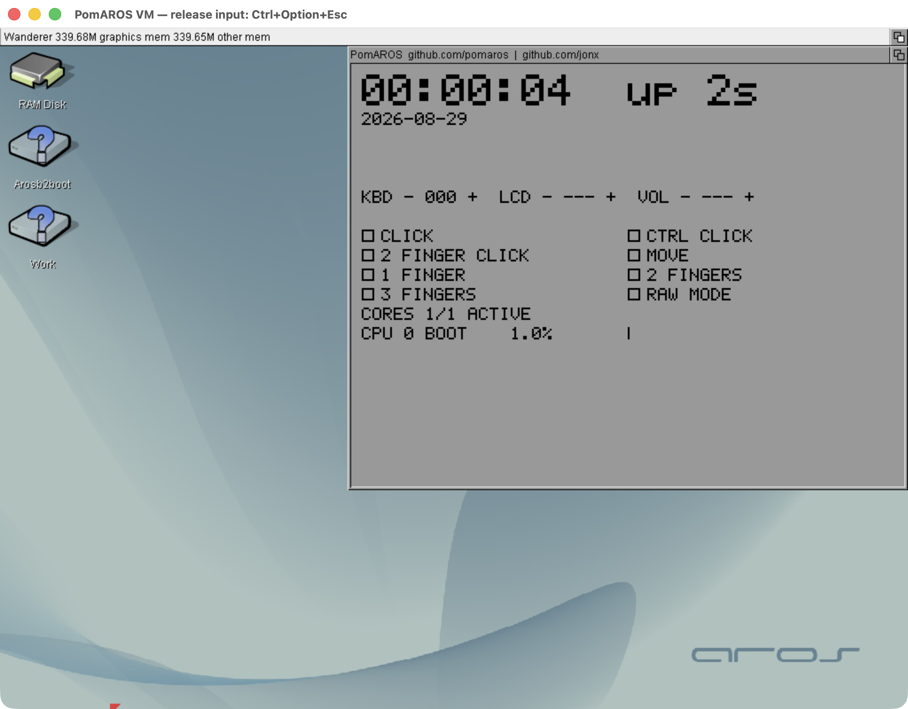

# PomAROS VM

PomAROS VM runs AROS in its own virtual machine on macOS, using Apple's
built-in Virtualization.framework. Running the application does not require
QEMU.



Actual windowed capture from an earlier development image. The public UP
monitor retains the clock and CPU rows; the native hardware controls shown
here are excluded. See [qualification and capture limits](docs/STATUS.md).

This project reuses the AROS kernel, UEFI loader and bundle tools.
The existing hosted PomAROS remains in its own repository.

## Shared guest source

The public [common AROS core](https://github.com/pomaros/aros-core) is shared
with PomAROS QEMU and Hosted. `CORE.lock` pins the exact source revision in the
separate `../aros-core` checkout. Acquire it with:

```sh
python3 tools/fetch-core.py
```

The helper creates a new detached checkout or verifies an existing clean pin;
it never resets a working tree. Build the AROS LLVM toolchain separately using
the [shared toolchain recipe](https://github.com/pomaros/pomaros-hosted/blob/main/GETTING-STARTED.md); a local toolchain is required at `../aros-crosstools`
(or the explicit `--toolchain` path). This repository owns the Virtualization.framework application
and the guest build/packaging tools consumed by `pomaros-qemu`. It contains no
separate copy of the kernel. Guest packages record their exact core revision;
macOS hosted binaries use a distinct ABI and cannot be reused as VM modules.
The native product repository stays empty and private during preparation.

The full desktop builds and boots in a normal window. Guest file exchange,
clipboard reconnection and clean persistent shutdown pass the bounded VM test.
This remains a development build; see [qualification and limits](docs/STATUS.md).

## Register policy

The macOS launcher follows Apple's ABI. The AROS guest runs independently and
can use the AArch64 x18 register normally. Hosted AROS reserves x18 because it
calls macOS directly. Native Apple and future Raspberry Pi builds follow the
ordinary register policy used by the VM guest. These targets share the same
kernel source.

## Standard AROS distribution

`make distrib` builds and packages the AROS desktop distribution for the VM,
including tools, utilities, preferences, fonts, themes, catalogs and datatypes.
Zed and Ferail are excluded. The result is
`artifacts/distribution/PomAROS VM.app`, with a separate `Distribution` profile
and persistent system files in `WORK:System`. See the
[distribution build and disk layout](docs/DISTRIBUTION.md).

## Use the application

Open the packaged `PomAROS VM.app` to start the AROS desktop in a normal window.
Saved window/fullscreen state is not restored; fullscreen is an explicit user
choice during a session. The application
includes its guest system; first launch creates a personal profile in
`~/Library/Application Support/PomAROS VM/Default/`. Network access uses the
Mac's connection through VZ NAT, so AROS needs no Wi-Fi configuration.

The guest gets 512 MiB of RAM unless the launcher is started with `--memory=MIB`
(bounded by Virtualization.framework on this Mac); `run-vz.py --memory` passes it through.

Press **Control+Option+Esc** to release mouse/keyboard input to macOS. Click the
VM window to return to AROS. The shortcut is also in the application menu.

Save persistent files on `WORK:`. `SYS:` and `RAM:` are RAM-backed in this
image. Quit the application normally to let the guest flush WORK before the
VM stops. Text and supported images in AROS clipboard unit 0 synchronize with
the Mac clipboard; individual applications must implement their Copy/Paste
commands. The integrated desktop includes the existing AROS editor: launch
`SYS:Tools/Editor` from the Shell and save documents on `WORK:`. Its text
Copy/Paste path has been exercised through the VZ view and Mac clipboard.
See [clipboard formats and limits](docs/CLIPBOARD.md).

Run `CPUInfo` in the AROS Shell to inspect the execution environment and CPU
information supplied by the system. Firmware identity distinguishes recognized
virtual machines from hosted execution; unknown platforms remain unidentified.
CPU counts describe the guest, not the physical Mac. Hosted macOS information
is separately labeled when available through hostlib.resource.

The profile's `Shared` folder is the Mac side of file exchange. In the AROS
Shell, for example:

```text
VMExchange PUT WORK:example.txt example.txt
VMExchange GET from-mac.txt WORK:from-mac.txt
```

Place `from-mac.txt` in `Shared` before downloading it. Both commands refuse
to overwrite an existing destination. See [file exchange](docs/HOST-SERVICES.md).

Replacing the app preserves the existing profile and its guest system. To
install updated guest components while keeping WORK, use the
[system image update procedure](docs/BUILD.md#updating-an-existing-vm-system-while-preserving-work),
which creates a separate profile disk and retains the old one for rollback.
The [application build procedure](docs/BUILD.md#standalone-macos-application)
describes packaging and isolated profiles. Current qualification limits are
listed in [stage 6](docs/STAGE6.md).

## Build and verify

On Apple Silicon with Xcode command-line tools, Homebrew LLVM/lld, QEMU,
mtools and dtc:

```sh
make
make test-host
make -C boot/arosboot
```

`make test-host` runs the host service, clipboard, storage and packaging gates.
`make test` additionally executes a real EL1 guest with Hypervisor.framework, checks x18
across VM exits, rejects a corrupted probe, and exercises the core FDT mapper
under ASan/UBSan. `AROS_CORE_SOURCE` selects the kernel checkout; the default
is `../aros-core`.

`tools/configure-core.py` configures an independent VM guest build.
`tools/package-core.py` packages its freshly built modules and records their
source revision and hashes. See the [complete build procedure](docs/BUILD.md).
`tools/run-qemu.py --esp DIR --output NEW_DIR` runs
with HVF, records exact inputs and requires both the kernel startup contract
and the Wanderer framebuffer check. `--accel tcg` is the software regression
lane; it never substitutes for an HVF failure.

`build/pomaros-vm DISK_IMAGE STATE_DIRECTORY [--headless]` launches the
Virtualization.framework application. The image must be a writable private
copy. Firmware state lives separately in `STATE_DIRECTORY`. The automated VZ qualification lane
is headless: `tools/run-vz.py --disk IMAGE --output NEW_DIR`. The VZ display
requires a virtio GPU driver. See [guest build instructions](docs/BUILD.md).

The [host services transport](docs/VSOCK.md) documents the vsock packet API
and bounded stream qualification.

See [the handoff](docs/STATUS.md) for measured results and work in
progress, [portable architecture](docs/PORTABILITY.md), and [provenance](docs/PROVENANCE.md) for reused code.


The optional [host file service](docs/HOST-SERVICES.md) exposes the VM state's
`Shared` directory over virtio-vsock (`--host-services`). Its VZ qualification
covers 64 KiB upload/readback and the standalone `VMExchange HELLO` command.
CLI PUT/GET also pass on the isolated guest FAT volume across a VM restart.
The [clipboard bridge](docs/CLIPBOARD.md) passes guest-device VZ tests for text
and images. A desktop package with `--host-services` starts VMSync automatically;
a bounded VZ desktop session verifies the daemon, text/images and foreground
session contention. [Network qualification](docs/NETWORK.md) covers DHCP and
AROSTCP UDP/TCP transfers through the host NAT gateway. Remaining acceptance
is tracked in [stage 6](docs/STAGE6.md).

The [SMP integration path](docs/SMP.md) describes upstream reuse, firmware CPU
discovery, per-CPU kernel work and bounded activation checks.
